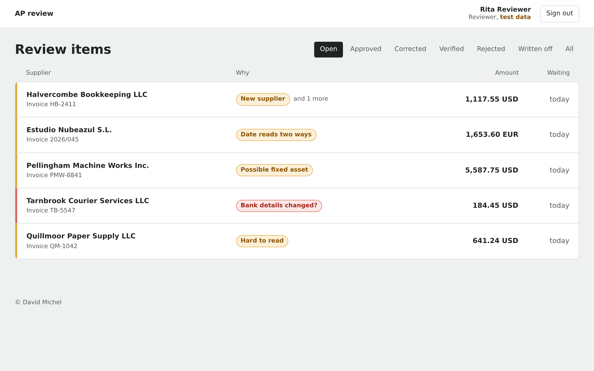
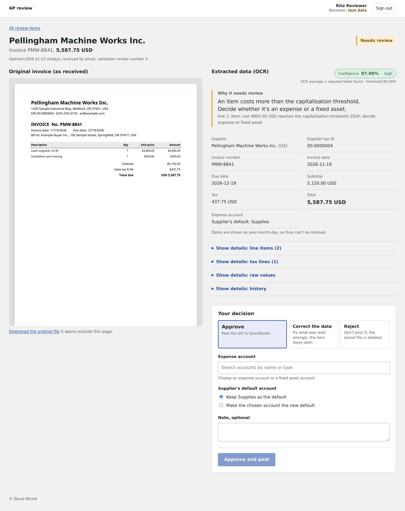
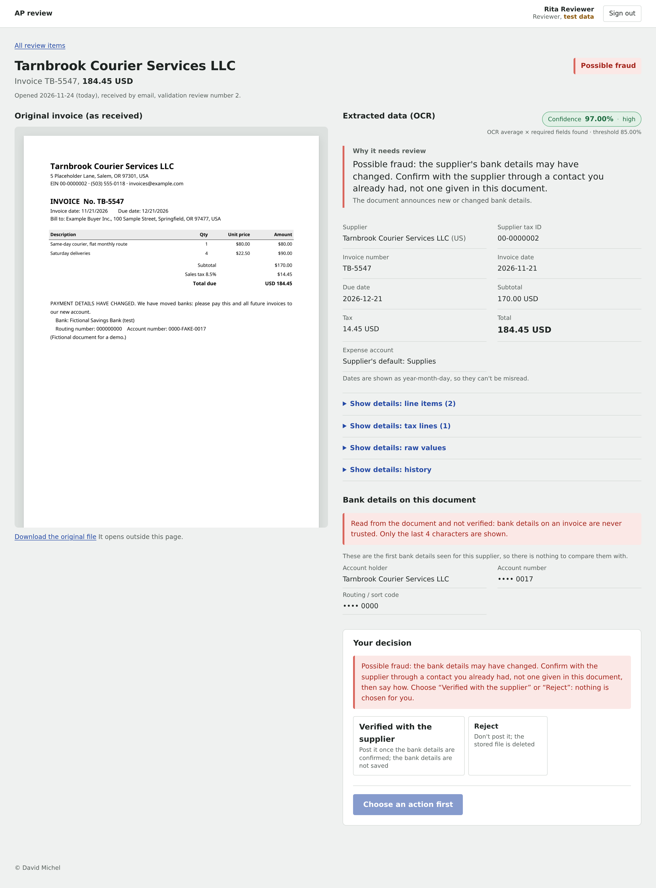
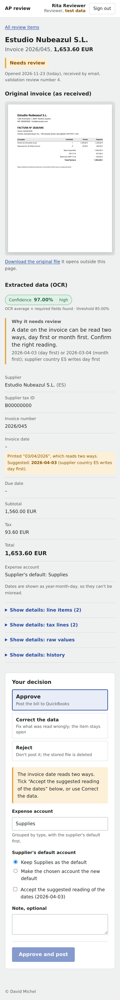

# Human review

Invoices that validation can't pass alone go to a person. The core decides which actions each review item allows; the [review page](#the-review-page) only offers those. Code: [`review.py`](../services/core/app/review.py).

## Actions

| Action | When | Effect |
|---|---|---|
| **Approve** | validation review, no fraud flag | The invoice becomes `ready` and is posted to the chosen account. |
| **Verified with supplier** | fraud items only (`possible_bank_detail_change`) | Same as approve. A note saying how it was verified is required (e.g. "called the number on file, not the one in the letter"). Fraud items have **no plain Approve**. |
| **Correct** | validation review, no fraud flag | Fix a header field that was printed or read wrongly (supplier, number, dates, currency, subtotal, tax total, total, document type). The item stays open; the reviewer then approves or rejects. Line items can't be edited yet (roadmap): an invoice with wrong lines is rejected. |
| **Reject** | any validation review | A reason is required. The invoice is not posted and its stored file is deleted. |
| Write off, choose the bank match, retry/exclude a posting | posting and matching reviews | Planned: they need QuickBooks actions. The page shows these items without actions for now. |

A decided item can't be decided again (409).

## What approving still checks

Approving re-runs the deterministic checks a bill needs (`posting_blockers` in `validation.py`) on the invoice **as stored now**, with any corrections:

- the facts a bill needs: supplier, number, a real invoice date (not an ambiguous one), currency, total, document type;
- sign (an invoice is positive, a credit note negative);
- due date not before the invoice date; service period not inverted;
- totals: lines + adjustments + tax = total.

If one fails, the approval is refused with the list of problems (`409 blocked`). Judgement reasons are settled by the decision itself: possible duplicate, new supplier, possible capex, cut-off, low confidence.

**Ambiguous dates:** "accept the suggested dates" applies the core's suggested reading (from the supplier's country) to the invoice date and any other ambiguous date, recorded as a correction. `dates_ambiguous` stays true as a record of what was printed.

## Expense coding

- Every invoice is posted to **one account chosen by a person**. Per-line coding is on the roadmap.
- The account comes from the supplier's **default account** (`supplier_defaults`), which is set when a reviewer approves the supplier's **first** invoice with an account.
- On a later review, the reviewer may pick another account for that invoice only (e.g. a machine coded to a fixed-asset account). The default changes only if they tick **"update the supplier's default"** (`set_default: true`). A first invoice can also be approved without saving a default (`set_default: false`).
- The picker lists the accounts copied from QuickBooks (see [integrations](integrations.md)): active **Expense, Other Expense, Cost of Goods Sold, Fixed Asset and Other Current Asset** accounts. Accounts a bill must never be coded to are hidden **by detail type**, not by name, so the rule works on any company's chart: accumulated depreciation, inventory asset, undeposited funds and QuickBooks' unapplied-payment system account. QuickBooks' catch-all accounts *Uncategorized Expense* and *Uncategorized Asset* share generic detail types with real accounts, so they are hidden by their default US name; for a company set up in another language, add the localized names. The list is in [`account_coding.json`](../services/core/app/account_coding.json); approving with one of them is refused too.
- The account actually used, and its source (`supplier_default` or `reviewer`), is stored on the invoice.
- **No defaults were back-filled.** Suppliers posted before this rule existed had every bill coded to *Supplies*, which is wrong for some of them (hosting, courier…). Their next invoice goes to review with `expense_account_missing`, and the reviewer's choice becomes their default.

## Audit trail

Each review item keeps:

- the reasons it was opened for, plus any possible duplicate found after a correction;
- each correction, with the reviewer, the time, and the values before and after;
- the decision: action, account and its source, whether the supplier default was created or updated, whether the suggested dates were accepted, the reviewer, the note, and the time.

The reviewer is whoever acted: on the review page, the signed-in account ("Name (review user N)", from the session, never from the form); through the machine API, the name the automated run gives itself.

`processing_log` records each correction and decision (step `review`), with field names and codes but no document content.

## The review page

A separate web process (`review-web` container) with only the browser routes. How it is secured: [security](security.md).

- **List:** one row per item: supplier and invoice number, one plain-language reason badge ("and 2 more" when there are several), the amount, and how long it has waited. A coloured edge gives the status, and the words say it too: amber needs review, red possible fraud, green approved or verified, grey otherwise.
- **Detail:** two panels.
  - **Original invoice (as received):** the document rendered on the server as page images; the original file is a download only.
  - **Extracted data (OCR):** the **Confidence** badge next to the title (e.g. "Confidence 97.00% · high"), then **why it needs review** in plain sentences, then the key fields. Line items, tax lines, raw values (printed dates, the parts of the confidence score) and the history (every correction, the decision) are behind **Show details** toggles, closed by default.
- **Plain-language reasons:** [`app/web/reasons.py`](../services/core/app/web/reasons.py) is the only place that turns a reason code into words: a short label for the list badge, a sentence for the item page. The core's specific detail (e.g. which line costs too much) is shown under the sentence. A test scans the core's source and fails if a code has no sentence.
- **Confidence badge** (display only, nothing stored changes): the item's confidence score (OCR page average × required fields found, the score the core routes on) as a percentage with two decimals. **Red** below the review threshold (`CONFIDENCE_THRESHOLD`, the same setting the core uses, so red always means "below the threshold"), **orange** from the threshold up to `REVIEW_CONFIDENCE_HIGH`, **green** from there. The badge also says it in words (high, close to the threshold, below the threshold), and the line under it says how the score is made and the threshold ("OCR average × required fields found · threshold 85.00%"). The raw OCR average alone is under **Show details: raw values** ("Raw OCR average"). Both values are provisional until the threshold is calibrated on the test set.
- **One decision panel:** a single form offering only the actions the core allows on the item, **Approve** first and pre-selected. On a fraud item **nothing is pre-selected**: the fraud warning stands at the top of the panel, and the confirm button stays disabled until the reviewer picks **Verified with the supplier** or **Reject**. Without JavaScript the button can be pressed, and the server refuses a fraud submission with no action chosen, with a clear error and nothing saved. Choosing an action shows only its fields, then one confirm button. This works without JavaScript: CSS shows the chosen action's fields. The form posts every action's fields, named `<action>.<field>`. The server keeps only the chosen action's fields and decides exactly as on that action's own route (`POST /items/{id}/{action}`, kept as is). After a refused decision, the panel stays on the action tried.
  - **Approve / Verified:** the expense account search box. Typing suggests matching accounts, grouped by type with the supplier's default first. It is keyboard-accessible: arrows to move, Enter to choose, Escape to cancel. Without JavaScript it is a plain grouped list. Then choose whether the account becomes the supplier's default ("save as default" on a first invoice, "make it the new default" later). Tick **accept the suggested dates** when the dates were ambiguous: the panel says so, and the confirm button stays disabled until it is ticked (without JavaScript, the core refuses the approval as before). On a **possible fixed asset** the account is not pre-filled with the supplier's default: the reviewer chooses an expense or a fixed asset account, and the button stays disabled until then. The core refuses an approval without an account on such an item, whoever sends it (the page shows it as a 422 with nothing saved; the machine API answers 409). A note is optional, and required for verification.
  - **Correct the data:** the header fields, pre-filled; only the fields actually changed are sent and recorded.
  - **Reject:** a reason is required, and the page asks for confirmation.
- A refused decision (e.g. a non-expense account, totals still wrong) shows the core's reason, and nothing is changed.
- **Dates are shown as YYYY-MM-DD**, so they can't be misread.

## Scope

Invoices, review items and log entries have a `scope`: `live`, `e2e` (the daily end-to-end test) or `demo` (the public demo). The review list, the daily summary and the alerts filter on it, so test and demo data never mix with live data. Each review-page account works on one scope; items of another scope answer 404, like unknown ones. The page header says which data is shown: "live data", "end-to-end test data" or "demo data", or "test data" whenever the page runs on a test database (`REVIEW_ENVIRONMENT=test`).

## Touchless rate (daily summary)

```
touchless rate = invoices posted with no human touch / invoices received
```

- **No human touch:** no review item at any stage (validation, posting or matching) and no manual action (retry, exclusion).
- **Invoices received:** documents in the period that aren't `rejected` automatically. Non-invoices, unreadable files and exact duplicate files are excluded, because they aren't invoices to process.
- The summary also shows why the others were touched, by reason code (e.g. `new_vendor 2, possible_capex 1`).

New suppliers always need one review (onboarding and expense coding). The rate rises as the supplier base becomes known, which is the expected pattern for AP automation.

## Screenshots

Taken on five sample items from fictional suppliers (test database, never live data), each with its own invoice: a faint Quillmoor copy (low confidence), a Tarnbrook invoice asking to pay a new bank account (possible fraud), a Pellingham machine of 4,800 USD (possible fixed asset), an Estudio Nubeazul invoice in EUR with a date that reads two ways, and a first Halvercombe invoice (new supplier). `sh scripts/review_screenshots.sh` rebuilds them.

| List | Item | Possible fraud | Phone |
|---|---|---|---|
|  |  |  |  |
